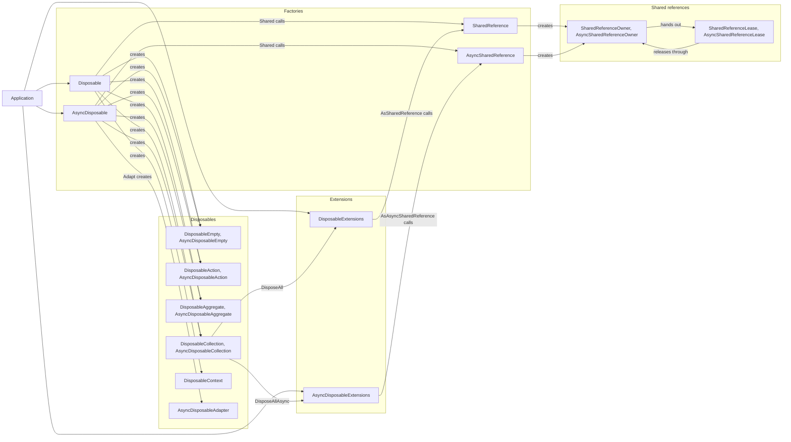

# Architecture

[//]: # "Maintainers: describe the components, as a diagram and a table (Component, Role), and the rules the design
keeps."

How NCode.Disposables is built. [assurance-case.md](assurance-case.md) explains why the design meets its security
requirements.

## Components

NCode.Disposables is one assembly and one NuGet package, `NCode.Disposables`, with every type in the namespace
`NCode.Disposables`. It targets the frameworks `src/NCode.Disposables/NCode.Disposables.csproj` declares and
depends on no other package.

## Design Rules

- Decisions the design rests on are recorded in [decisions/](decisions/README.md).
- Warnings are errors ([ADR-0100](decisions/project-template/0100-warnings-are-errors-in-every-project.md)), and
  disallowed APIs are banned at build time
  ([ADR-0102](decisions/project-template/0102-disallowed-apis-are-banned-at-build-time.md)).
- The public API is tracked and evolves compatibly
  ([ADR-0131](decisions/project-template/0131-public-api-is-tracked-and-evolves-compatibly.md)), and each package is
  validated against the last published package
  ([ADR-0147](decisions/project-template/0147-packages-are-validated-against-the-last-published-package.md)).

## Build and Release

CI runs the project's commands on every pull request
(`.github/workflows/ci.yml`). Releases are tagged when `AGENTS.md`'s Landing section sets `release: tag`, and published too with
`tag+release`, as
[ADR-0016](decisions/project-template/0016-releases-are-tagged-and-published-when-their-pull-request-merges.md)
records. `publish.yml` tests and packs the tagged commit, pushes to nuget.org through trusted publishing once a
maintainer approves the `nuget` environment, and calls `release-provenance.yml` and `raise-baseline.yml`
([ADR-0137](decisions/project-template/0137-the-release-workflow-starts-package-publishing.md),
[ADR-0151](decisions/project-template/0151-release-follow-ups-are-jobs-publish-calls.md)).
