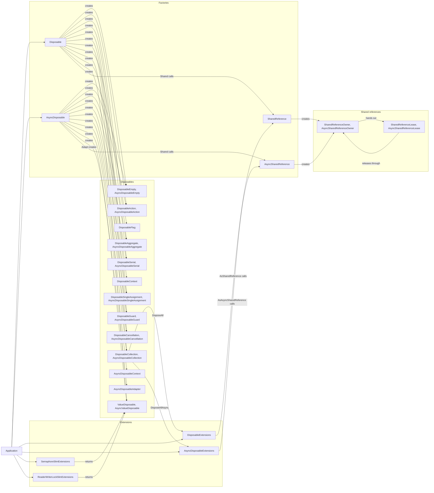

# Architecture

[//]: # "Maintainers: describe the components, as a diagram and a table (Component, Role), and the rules the design
keeps."

How NCode.Disposables is built. [assurance-case.md](assurance-case.md) explains why the design meets its security
requirements.

## Components

NCode.Disposables is one assembly and one NuGet package, `NCode.Disposables`, with every type in the namespace
`NCode.Disposables`. It targets the frameworks `src/NCode.Disposables/NCode.Disposables.csproj` declares and
depends on no other package.

| Component | Role |
| --- | --- |
| `Disposable` | Static factory that returns the concrete types: `Empty`, `Create` (an `Action` or a `Func<TResult>`, each also taking up to eight arguments), `CreateRepeatable`, `CreateValue`, `Aggregate`, `Serial`, `SingleAssignment`, `Guard`, `Cancellation`, `Flag`, `Collection`, `CollectionIgnoringExceptions`, `Context`, `PostingContext` and `Shared`, which calls `SharedReference.Create`. |
| `AsyncDisposable` | Static factory that returns the concrete types: `Empty`, `Create` (a `Func<ValueTask>`, which also takes up to eight arguments, or an `Action`), `CreateRepeatable`, `CreateValue`, `Adapt`, `AdaptRepeatable`, `Aggregate`, `Serial`, `SingleAssignment`, `Guard`, `Cancellation`, `Collection`, `CollectionIgnoringExceptions`, `Context` and `Shared`, which calls `AsyncSharedReference.Create`. |
| `DisposableEmpty`, `AsyncDisposableEmpty` | Do nothing; `Singleton` is the instance `Empty` returns. |
| `DisposableAction`, `AsyncDisposableAction` | Run a delegate on the first dispose, taken with `Interlocked.Exchange` so it runs once across threads, or on every dispose from `CreateRepeatable`. |
| `DisposableAggregate`, `AsyncDisposableAggregate` | Hold one replaceable resource in `Disposable`, swapped atomically; disposing the aggregate disposes the resource it holds, and after disposal `Disposable` reads `null` and a resource set on it is disposed ([ADR-1004](decisions/1004-a-resource-handed-to-a-disposed-holder-is-disposed.md)); `AsyncDisposableAggregate`'s setter throws `ObjectDisposedException` after disposal, and `SetDisposableAsync` disposes the resource. |
| `DisposableSerial`, `AsyncDisposableSerial` | Hold one resource and dispose the previous one when it is replaced. |
| `DisposableSingleAssignment`, `AsyncDisposableSingleAssignment` | Take one resource, once. |
| `DisposableGuard<T>`, `AsyncDisposableGuard<T>` | Dispose a resource unless `Release()` hands ownership on. |
| `DisposableCancellation`, `AsyncDisposableCancellation` | Cancel a token on dispose. |
| `DisposableFlag` | Only records that it was disposed. |
| `DisposableCollection`, `AsyncDisposableCollection` | An `ICollection<IDisposable>` and an `ICollection<IAsyncDisposable>` that dispose their items in reverse order on the first dispose, through `DisposeAll` and `DisposeAllAsync`; every member takes one lock and enumeration walks a snapshot; `Add` after disposal disposes the item, and for the async collection `Add` throws and `AddAsync` disposes the item. |
| `DisposableContext` | Disposes a resource once on a `SynchronizationContext`, through `Send`, or through `Post` from `Disposable.PostingContext`, between `OperationStarted` and `OperationCompleted`. |
| `AsyncDisposableContext` | Posts the async disposal of a resource to a `SynchronizationContext`. |
| `AsyncDisposableAdapter` | An `IAsyncDisposable` over an `IDisposable`, disposing it once, or on every call from `AsyncDisposable.AdaptRepeatable`; it throws `ArgumentNullException` for a `null` disposable ([ADR-1008](decisions/1008-a-disposable-that-wraps-a-resource-rejects-a-null-resource.md)). |
| `ValueDisposable<TState>`, `AsyncValueDisposable<TState>` | Allocation-free structs that run a static delegate with their state on every dispose; non-idempotent ([ADR-1006](decisions/1006-value-disposables-and-lock-scopes-are-non-idempotent-structs.md)). |
| `IDisposalStatus` | Exposes `IsDisposed`; the disposables are concrete sealed types that report it ([ADR-1005](decisions/1005-disposables-are-concrete-sealed-types-that-report-their-disposal-status.md)). |
| `SharedReference`, `AsyncSharedReference` | Static `Create(value)` for an `IDisposable` or an `IAsyncDisposable`, and `Create(value, onRelease)` for any value; each creates an owner and returns its first lease. |
| `SharedReferenceOwner<T>`, `AsyncSharedReferenceOwner<T>` | The reference count, changed with lock-free atomic operations; the release action runs once, on the thread that releases the last lease; interfaces `ISharedReferenceOwner<T>`, `IAsyncSharedReferenceOwner<T>`. |
| `SharedReferenceLease<T>`, `AsyncSharedReferenceLease<T>` | `readonly struct` leases with `Value`, `IsActive`, `AddReference`, `TryAddReference`, and `Dispose` or `DisposeAsync`, which releases one reference. |
| `DisposableExtensions` | `DisposeAsyncIfAvailable()`, `AsSharedReference()`, and `DisposeAll()`, which disposes each `IDisposable` in reverse order, also one that implements `IAsyncDisposable`, and throws `InvalidOperationException` for an item that implements only `IAsyncDisposable` ([ADR-1001](decisions/1001-synchronous-disposal-disposes-an-item-that-implements-both-interfaces-through-idisposable.md)); `DisposeAllIgnoringExceptions()` ignores the exceptions items throw. |
| `AsyncDisposableExtensions` | `AsAsyncSharedReference()` and `DisposeAllAsync()`, which prefers `DisposeAsync` ([ADR-1002](decisions/1002-the-async-shared-reference-extension-is-asasyncsharedreference.md)); `DisposeAllIgnoringExceptionsAsync()` ignores the exceptions items throw. |
| `SemaphoreSlimExtensions` | `Lock()` and `LockAsync()`, which return a `ValueDisposable` lock scope that releases the semaphore on dispose and throws `OperationCanceledException` when the wait is cancelled ([ADR-1006](decisions/1006-value-disposables-and-lock-scopes-are-non-idempotent-structs.md)). |
| `ReaderWriterLockSlimExtensions` | `ReadLock()`, `UpgradeableReadLock()` and `WriteLock()`, which return a `ValueDisposable` lock scope that exits the lock on dispose ([ADR-1006](decisions/1006-value-disposables-and-lock-scopes-are-non-idempotent-structs.md)). |
| `NCode.Disposables.Tests` | xUnit tests of every type, and in `ReadmeSamplesTests.cs` the README samples ([ADR-1000](decisions/1000-readme-samples-are-compiled-tests-that-markdownsnippets-copies-into-the-readmes.md)). |
| `NCode.Disposables.Site.Tests` | The documentation site's samples, compiled against the public API only ([ADR-1010](decisions/1010-site-samples-are-compiled-tests-in-a-project-of-their-own-included-by-key-when-the-site-is-built.md)) |
| `docs/site/` | The documentation site's pages, settings, components and data, built by NCodeGroup/docs ([ADR-1009](decisions/1009-the-documentation-site-is-narrative-guides-built-by-a-shared-toolchain-outside-this-repository.md)) |

The package does no I/O and starts no threads, and it keeps no mutable static state: its only static values are the
`Singleton` instances of the empty disposables, the holders' private `Sentinel` markers and the lock scopes' cached
release delegates, none of which changes once created. It shows people no text: the exceptions it throws on purpose are
`ArgumentNullException`, `ObjectDisposedException` and `InvalidOperationException` and, from the lock scopes,
`OperationCanceledException`, for developers.

## Design Rules

- Decisions the design rests on are recorded in [decisions/](decisions/README.md).
- Synchronous disposal disposes an item that implements both interfaces through `IDisposable`
  ([ADR-1001](decisions/1001-synchronous-disposal-disposes-an-item-that-implements-both-interfaces-through-idisposable.md)).
- An extension name used for one disposal interface is never reused for the other
  ([ADR-1002](decisions/1002-the-async-shared-reference-extension-is-asasyncsharedreference.md)).
- A resource handed to a disposed holder is disposed
  ([ADR-1004](decisions/1004-a-resource-handed-to-a-disposed-holder-is-disposed.md)).
- Disposables are concrete sealed types that report their disposal status
  ([ADR-1005](decisions/1005-disposables-are-concrete-sealed-types-that-report-their-disposal-status.md)).
- Value disposables and lock scopes are non-idempotent structs
  ([ADR-1006](decisions/1006-value-disposables-and-lock-scopes-are-non-idempotent-structs.md)).
- Warnings are errors ([ADR-0100](decisions/project-template/0100-warnings-are-errors-in-every-project.md)), and
  disallowed APIs are banned at build time
  ([ADR-0102](decisions/project-template/0102-disallowed-apis-are-banned-at-build-time.md)).
- The public API is tracked and evolves compatibly
  ([ADR-0131](decisions/project-template/0131-public-api-is-tracked-and-evolves-compatibly.md)), and each package is
  validated against the last published package
  ([ADR-0147](decisions/project-template/0147-packages-are-validated-against-the-last-published-package.md)).

## Build and Release

CI runs the project's commands on every pull request
(`.github/workflows/ci.yml`). Releases are tagged when `AGENTS.md`'s Landing section sets `release: tag`, and published too with
`tag+release`, as
[ADR-0016](decisions/project-template/0016-releases-are-tagged-and-published-when-their-pull-request-merges.md)
records. `publish.yml` tests and packs the tagged commit, pushes to nuget.org through trusted publishing once a
maintainer approves the `nuget` environment, and calls `release-provenance.yml` and `raise-baseline.yml`
([ADR-0137](decisions/project-template/0137-the-release-workflow-starts-package-publishing.md),
[ADR-0151](decisions/project-template/0151-release-follow-ups-are-jobs-publish-calls.md)).

`docs.yml` builds the documentation site with NCodeGroup/docs, pinned by commit, on every pull request and publishes it
to GitHub Pages from every push to the default branch, at https://disposables.ncode.io/
([ADR-1012](decisions/1012-the-documentation-site-is-published-to-github-pages-from-the-default-branch.md),
[ADR-1013](decisions/1013-the-documentation-site-is-served-at-disposables-ncode-io.md)).
