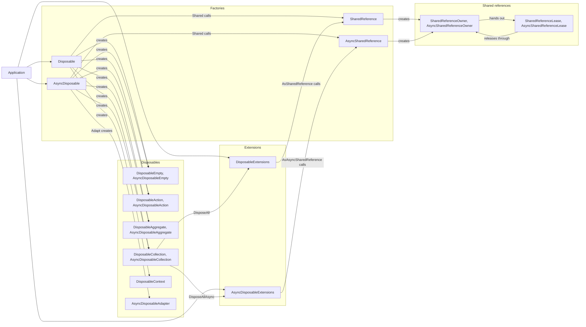

# Architecture

[//]: # "Maintainers: describe the components, as a diagram and a table (Component, Role), and the rules the design
keeps."

How NCode.Disposables is built. [assurance-case.md](assurance-case.md) explains why the design meets its security
requirements.

## Components

NCode.Disposables is one assembly and one NuGet package, `NCode.Disposables`, with every type in the namespace
`NCode.Disposables`. It targets the frameworks `src/NCode.Disposables/NCode.Disposables.csproj` declares and
depends on no other package.

| Component | Role |
| --- | --- |
| `Disposable` | Static factory: `Empty`, `Create` (an `Action`, or one taking up to eight arguments), `Aggregate`, `Collection`, `Context`, and `Shared`, which calls `SharedReference.Create`. |
| `AsyncDisposable` | Static factory: `Empty`, `Create` (a `Func<ValueTask>` or an `Action`), `Adapt`, `Aggregate`, `Collection`, and `Shared`, which calls `AsyncSharedReference.Create`. |
| `DisposableEmpty`, `AsyncDisposableEmpty` | Do nothing; `Singleton` is the instance `Empty` returns. |
| `DisposableAction`, `AsyncDisposableAction` | Run a delegate on the first dispose, taken with `Interlocked.Exchange` so it runs once across threads, or on every dispose with `idempotent: false`. |
| `DisposableAggregate`, `AsyncDisposableAggregate` | Hold one replaceable resource in `Disposable`, swapped atomically; disposing the aggregate disposes the resource it holds, and later reads or writes throw `ObjectDisposedException`; interfaces `IDisposableAggregate`, `IAsyncDisposableAggregate`. |
| `DisposableCollection`, `AsyncDisposableCollection` | An `ICollection<IDisposable>` and an `ICollection<IAsyncDisposable>` that dispose their items in reverse order on the first dispose, through `DisposeAll` and `DisposeAllAsync`; `Add`, `Remove`, `Clear` and enumeration hold no lock; interfaces `IDisposableCollection`, `IAsyncDisposableCollection`. |
| `DisposableContext` | Disposes a resource once on a `SynchronizationContext`, through `Send`, or through `Post` with `async: true`, between `OperationStarted` and `OperationCompleted`. |
| `AsyncDisposableAdapter` | An `IAsyncDisposable` over an `IDisposable`, disposing it once, or on every call with `idempotent: false`. |
| `SharedReference`, `AsyncSharedReference` | Static `Create(value)` for an `IDisposable` or an `IAsyncDisposable`, and `Create(value, onRelease)` for any value; each creates an owner and returns its first lease. |
| `SharedReferenceOwner<T>`, `AsyncSharedReferenceOwner<T>` | The reference count, changed with lock-free atomic operations; the release action runs once, on the thread that releases the last lease; interfaces `ISharedReferenceOwner<T>`, `IAsyncSharedReferenceOwner<T>`. |
| `SharedReferenceLease<T>`, `AsyncSharedReferenceLease<T>` | `readonly struct` leases with `Value`, `IsActive`, `AddReference`, `TryAddReference`, and `Dispose` or `DisposeAsync`, which releases one reference. |
| `DisposableExtensions` | `DisposeAsyncIfAvailable()`, `AsSharedReference()`, and `DisposeAll()`, which disposes each `IDisposable` in reverse order, also one that implements `IAsyncDisposable`, and throws `InvalidOperationException` for an item that implements only `IAsyncDisposable` ([ADR-1001](decisions/1001-synchronous-disposal-disposes-an-item-that-implements-both-interfaces-through-idisposable.md)). |
| `AsyncDisposableExtensions` | `AsAsyncSharedReference()`, `DisposeAllAsync()`, which prefers `DisposeAsync`, and the obsolete `AsSharedReference()` ([ADR-1002](decisions/1002-the-async-shared-reference-extension-is-asasyncsharedreference.md)). |
| `NCode.Disposables.Tests` | xUnit tests of every type, and in `ReadmeSamplesTests.cs` the README samples ([ADR-1000](decisions/1000-readme-samples-are-compiled-tests-that-markdownsnippets-copies-into-the-readmes.md)). |

The package does no I/O, starts no threads, and keeps no static state beyond the `Singleton` instances of the empty
disposables. It shows people no text: the exceptions it throws on purpose are `ArgumentNullException`,
`ObjectDisposedException` and `InvalidOperationException`, for developers.

## Design Rules

- Decisions the design rests on are recorded in [decisions/](decisions/README.md).
- Synchronous disposal disposes an item that implements both interfaces through `IDisposable`
  ([ADR-1001](decisions/1001-synchronous-disposal-disposes-an-item-that-implements-both-interfaces-through-idisposable.md)).
- An extension name used for one disposal interface is never reused for the other
  ([ADR-1002](decisions/1002-the-async-shared-reference-extension-is-asasyncsharedreference.md)).
- Warnings are errors ([ADR-0100](decisions/project-template/0100-warnings-are-errors-in-every-project.md)), and
  disallowed APIs are banned at build time
  ([ADR-0102](decisions/project-template/0102-disallowed-apis-are-banned-at-build-time.md)).
- The public API is tracked and evolves compatibly
  ([ADR-0131](decisions/project-template/0131-public-api-is-tracked-and-evolves-compatibly.md)), and each package is
  validated against the last published package
  ([ADR-0147](decisions/project-template/0147-packages-are-validated-against-the-last-published-package.md)).

## Build and Release

CI runs the project's commands on every pull request
(`.github/workflows/ci.yml`). Releases are tagged when `AGENTS.md`'s Landing section sets `release: tag`, and published too with
`tag+release`, as
[ADR-0016](decisions/project-template/0016-releases-are-tagged-and-published-when-their-pull-request-merges.md)
records. `publish.yml` tests and packs the tagged commit, pushes to nuget.org through trusted publishing once a
maintainer approves the `nuget` environment, and calls `release-provenance.yml` and `raise-baseline.yml`
([ADR-0137](decisions/project-template/0137-the-release-workflow-starts-package-publishing.md),
[ADR-0151](decisions/project-template/0151-release-follow-ups-are-jobs-publish-calls.md)).
